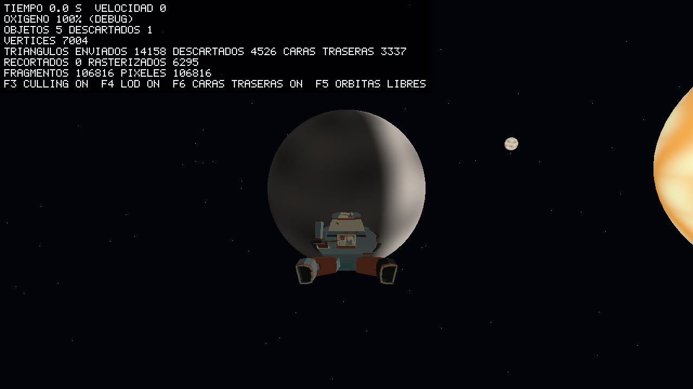

# UMBRAL: Asfixia Lúcida

Proyecto final de Gráficas por Computadora: exploración de un sistema solar pequeño desde una nave deteriorada, con un renderizador 3D **por software** escrito en Rust.

> **Estado actual: Hito 1 (parte de Persona 1).** Hay pipeline 3D por software con matrices modelo-vista-proyección, recorte contra el plano cercano, z-buffer, atributos interpolados con corrección de perspectiva y shader de fragmentos por `enum`. La escena tiene un Sol, tres planetas que orbitan y rotan según el tiempo, y la nave con vuelo básico. **Aún no hay** oxígeno, recursos, registros, planetas con identidad propia, procedural ni Asfixia Lúcida.



## Requisitos

- Rust y Cargo con soporte de la edición 2024. El manifiesto declara `rust-version = 1.88`; la base se verificó con **Rust 1.97.0 en Windows**. No se ha probado en Linux ni macOS.
- Dependencias fijadas en `Cargo.lock`: `minifb 0.28.0` (ventana y teclado) y `png 0.18.1` (exportar PNG). Ninguna dibuja ni carga geometría. Su aprobación académica sigue **pendiente** (UMB-004).

## Ejecutar

```bash
cargo run --release --locked
```

| Tecla | Acción |
|---|---|
| `W` / `S` | Empuje hacia adelante / frenar y retroceder (suave, depende del tiempo) |
| `A` / `D` o flechas izquierda/derecha | Guiñada |
| Flechas arriba/abajo | Cabeceo |
| `Q` / `E` | Alabeo |
| `Shift` | Impulso ×5 para cruzar el sistema |
| `R` | Reiniciar la nave |
| `P` | Guardar el framebuffer actual en PNG |
| `F1` | Mostrar/ocultar el overlay técnico (FPS, contadores de trabajo, interruptores) |
| `F3` | Activar/desactivar el descarte por frustum |
| `F4` | Activar/desactivar el nivel de detalle (LOD) |
| `F5` | Congelar/reanudar las órbitas |
| `F6` | Activar/desactivar el descarte de caras traseras |
| `1`–`4` | Oxígeno de depuración 100 / 50 / 25 / 5 % (aún sin efecto visual) |
| `Esc` | Salir |

El título de la ventana muestra FPS, velocidad y contadores (triángulos enviados, descartados y rasterizados, fragmentos).

Opciones: `--headless`, `--output archivo.png`, `--frames N` (cierra la ventana tras N frames), `--width N`, `--height N`, `--time S` (tiempo simulado inicial), `--near CUERPO` (arranca junto al cuerpo 0 = Sol, 1 = Antena, 2 = Osario, 3 = Vigilia), `--no-culling`, `--no-lod`, `--overlay` (dibuja el overlay también en `--headless`), `--legacy` (visor ortográfico heredado, donde `A`/`D` rotan la nave), `--help`.

Medición de rendimiento sin ventana: `cargo run --release --example frame_time`.

### Resolución

| Parámetro | Valor |
|---|---|
| Por defecto | **1280×720 (16:9)**, decisión aprobada; definida solo en `src/config.rs` |
| `--width N` / `--height N` | Enteros positivos; cada uno sustituye su valor por defecto de forma independiente |
| Límite | `width × height ≤ 16 777 216` píxeles (`MAX_PIXELS`, equivale a 4096×4096), validado por `Framebuffer::new` antes de reservar memoria, incluido el desbordamiento de la multiplicación |

La ventana y el framebuffer se crean con las mismas dimensiones: no hay escalado ni cambio de tamaño de ventana. Un valor faltante, no entero, cero o demasiado grande termina con código 1 y un mensaje en `Error: ...`, sin escribir PNG ni abrir ventana. No se ha medido rendimiento a ninguna resolución: todavía no existe la escena del juego.

- La rotación avanza 0.03 rad **por frame**, no por tiempo: es comportamiento heredado y se sustituye en UMB-106.
- `P` escribe por defecto en `renders/nave.png`, ruta que `.gitignore` no excluye. Para pruebas manuales conviene `--output renders/tmp/vista.png`.
- Los controles se documentan a partir del código; su validación manual en ventana corresponde a Charlie y **no está registrada todavía**.

### Generar imagen sin ventana

```bash
cargo run --release --locked -- --headless --output renders/smoke/frame_720p.png
```

Usa el mismo renderer que la ventana, guarda el PNG a la resolución elegida (por defecto 1280×720) y termina. `renders/smoke/` y `renders/tmp/` están en `.gitignore`.

Para reproducir el **baseline heredado** hay que pedir `--legacy` y 1280×960:

```bash
cargo run --release --locked -- --legacy --headless --width 1280 --height 960 --output renders/smoke/legacy_960p.png
```

El PNG resultante debe ser idéntico byte a byte a `tests/fixtures/legacy_ship_1280x960.png`. El render a 720p es una imagen distinta y no reemplaza ese baseline.

## Validación local

```bash
cargo fmt --check
cargo clippy --all-targets --locked -- -D warnings
cargo test --locked
cargo run --release --locked -- --headless --output renders/smoke/frame_720p.png
cargo run --release --locked -- --legacy --headless --width 1280 --height 960 --output renders/smoke/legacy_960p.png
```

Con las dependencias ya descargadas puede añadirse `--offline`. Las pruebas cubren framebuffer y profundidad, rasterización en ambos órdenes de vértices, lector OBJ/MTL con la nave real, exportación PNG, la línea de comandos (resolución por defecto 1280×720 y rechazo de dimensiones inválidas) y una **regresión determinista de la nave**: `tests/ship_baseline.rs` compara el render a 1280×960 píxel a píxel y el PNG headless con `--width 1280 --height 960` byte a byte contra `tests/fixtures/legacy_ship_1280x960.png`. Ese fixture se generó con este repositorio y es idéntico al `renders/nave.png` del laboratorio de origen (SHA-256 `590617750436c32056a02602f94cfb9243e4398599005e94efefa99683e80bfa`).

## Estructura

```text
src/main.rs                 Línea de comandos; delega en app.rs (o en el visor --legacy)
src/app.rs                  Bucle de ventana, entrada y modo headless del juego
src/math/                   Vec2/3/4, Mat4 (MVP, Euler, Rodrigues) y Transform
src/renderer/pipeline.rs    draw_model: vértices, recorte, viewport, rasterización con shader
src/renderer/clipping.rs    Códigos de salida, recorte del plano cercano, Frustum
src/renderer/shader.rs      ShaderKind, ShaderContext, Material, shade_fragment, sRGB
src/renderer/rasterizer.rs  triangle (heredado) y triangle_shaded (perspectiva correcta)
src/renderer/stats.rs       RenderStats: contadores de trabajo
src/renderer/framebuffer.rs Color y z-buffer
src/renderer/image.rs       Exportación a PNG
src/renderer/legacy.rs      Visor heredado, solo con --legacy (baseline de regresión)
src/debug/overlay.rs       Overlay técnico con fuente de mapa de bits propia (F1)
src/scene/                  Cámara, nave, sistema solar y World (update + render)
src/assets/obj.rs           Lector OBJ/MTL: v, vt, vn, caras triangulares, Kd, esfera envolvente
src/assets/primitives.rs    Esfera UV generada por código
assets/models/ship/         OBJ y MTL de la nave
examples/frame_time.rs      Tiempo por cuadro con y sin descarte
tests/                      Pruebas heredadas, transformaciones, pipeline y mundo
docs/architecture.md        Propietarios, contratos y decisiones
```

## Limitaciones conocidas

- Los tres planetas comparten esfera y el shader iluminado; solo cambian tamaño, color y órbita. La identidad propia (UMB-302), props, procedural y shaders de Asfixia Lúcida son de Persona 3.
- Los shaders `LucidSurface` y `VoidEye` son marcadores que reutilizan `LitPlanet`; `AnimatedSun` es una primera versión (UMB-307).
- No hay colisión, gravedad ni asistencia orbital (Persona 2). La cámara es de seguimiento fija detrás de la nave.
- El LOD solo cubre las esferas de los cuerpos (tres niveles por tamaño aparente, con histéresis del 15 %); los props de Persona 3 aún no lo usan.
- Sin recorte contra los otros cinco planos: los triángulos se limitan por la caja de la pantalla, no se recortan. El descarte de caras traseras solo se aplica a los planetas (la nave no lo usa porque su orientación de caras no se ha verificado).
- El descarte de objetos reduce vértices procesados, pero a 720p el tiempo lo domina el relleno de fragmentos; el efecto en milisegundos es pequeño.
- La ruta de los assets se fija con `CARGO_MANIFEST_DIR` al compilar: el binario no es reubicable.
- El baseline de la nave solo se ha verificado en Windows x86_64.
- El orden y sentido de la nave (`SHIP_MODEL_YAW`) se ajustó mirando un render; no hay prueba automática.

## Origen y atribución

- Código base, pruebas y modelo: [`carga-modelos-24531`](https://github.com/SrCharlied/carga-modelos-24531), commit `51fbaed7d6c5db12a264ce91b86f450e7b05dd34`, autor SrCharlied según su historial. El historial Git de ese laboratorio no se importó; esta referencia sustituye a la atribución por historial.
- Origen y hashes de la nave: `assets/models/ship/README.md`.

## Contribuciones

| Quién | Aporte en este repositorio |
|---|---|
| SrCharlied | Laboratorio base (código, pruebas, modelo) y dirección del proyecto |
| Persona 1, 2, 3 | Asignación pendiente; ver responsabilidades en `docs/architecture.md` |

## Uso de asistencia de IA

- **UMB-001/UMB-002** (importación, renombre, reorganización de módulos, prueba de regresión de la nave y esta documentación inicial) se realizaron con **Claude Code** (Anthropic) bajo dirección de Charlie, con planificación y revisión apoyadas por un asistente de IA local. La revisión humana de este trabajo está pendiente.
- El uso de IA en el laboratorio de origen no está declarado en su README; debe completarlo su autor.
