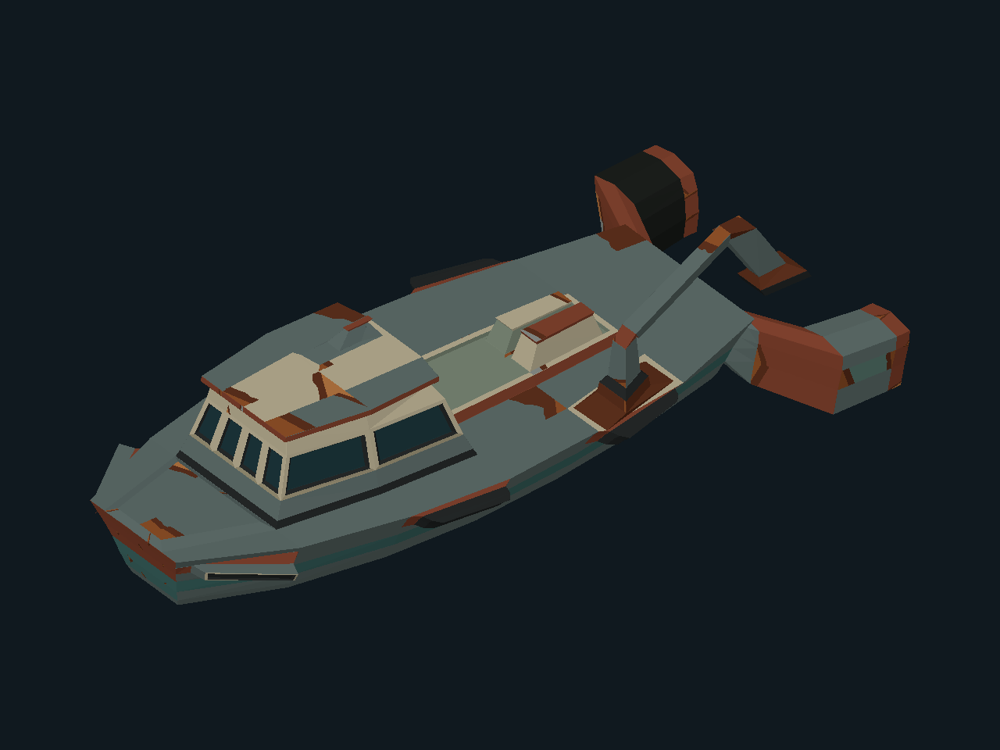

# UMBRAL: Asfixia Lúcida

Proyecto final de Gráficas por Computadora: exploración de un sistema solar pequeño desde una nave deteriorada, con un renderizador 3D **por software** escrito en Rust.

> **Estado actual: Hito 0 (UMB-001/UMB-002).** El repositorio contiene solamente la base heredada de `carga-modelos-24531`, renombrada y reorganizada sin cambiar su resultado visual. **Aún no hay** matrices MVP, perspectiva, escena, planetas, shaders de fragmentos ni gameplay.



*Baseline del visor heredado (proyección ortográfica, autoencuadre, color plano por cara). Es la referencia de regresión, no el aspecto final del proyecto.*

## Requisitos

- Rust y Cargo con soporte de la edición 2024. El manifiesto declara `rust-version = 1.88`; la base se verificó con **Rust 1.97.0 en Windows**. No se ha probado en Linux ni macOS.
- Dependencias fijadas en `Cargo.lock`: `minifb 0.28.0` (ventana y teclado) y `png 0.18.1` (exportar PNG). Ninguna dibuja ni carga geometría. Su aprobación académica sigue **pendiente** (UMB-004).

## Ejecutar

```bash
cargo run --release --locked
```

| Tecla | Acción |
|---|---|
| `A` / `D` o flechas izquierda/derecha | Rotar la nave sobre el eje vertical |
| `R` | Restablecer el ángulo inicial |
| `P` | Guardar el framebuffer actual en PNG |
| `Esc` | Salir |

Opciones: `--headless`, `--output archivo.png`, `--frames N` (cierra la ventana tras N frames), `--help`.

- La rotación avanza 0.03 rad **por frame**, no por tiempo: es comportamiento heredado y se sustituye en UMB-106.
- `P` escribe por defecto en `renders/nave.png`, ruta que `.gitignore` no excluye. Para pruebas manuales conviene `--output renders/tmp/vista.png`.
- Los controles se documentan a partir del código; su validación manual en ventana corresponde a Charlie y **no está registrada todavía**.

### Generar imagen sin ventana

```bash
cargo run --release --locked -- --headless --output renders/smoke/frame.png
```

Usa el mismo renderer que la ventana, guarda el PNG (1280×960) y termina. `renders/smoke/` y `renders/tmp/` están en `.gitignore`.

## Validación local

```bash
cargo fmt --check
cargo clippy --all-targets --locked -- -D warnings
cargo test --locked
cargo run --release --locked -- --headless --output renders/smoke/frame.png
```

Con las dependencias ya descargadas puede añadirse `--offline`. Las pruebas cubren framebuffer y profundidad, rasterización en ambos órdenes de vértices, lector OBJ/MTL con la nave real, exportación PNG, la línea de comandos y una **regresión determinista de la nave**: `tests/ship_baseline.rs` compara el render píxel a píxel y el PNG headless byte a byte contra `tests/fixtures/legacy_ship_1280x960.png`. Ese fixture se generó con este repositorio y es idéntico al `renders/nave.png` del laboratorio de origen (SHA-256 `590617750436c32056a02602f94cfb9243e4398599005e94efefa99683e80bfa`).

## Estructura

```text
src/main.rs                 Línea de comandos, ventana minifb y modo headless
src/lib.rs                  Raíz de la biblioteca
src/assets/obj.rs           Lector propio OBJ/MTL (posiciones, caras trianguladas, Kd)
src/assets/mod.rs           Ruta de la nave
src/renderer/framebuffer.rs Color y z-buffer
src/renderer/rasterizer.rs  Relleno de triángulos con baricéntricas
src/renderer/image.rs       Exportación del framebuffer a PNG
src/renderer/legacy.rs      Visor heredado (ortográfico, autoencuadre); se reemplaza en UMB-101/102
assets/models/ship/         OBJ y MTL de la nave, con su origen y hashes
tests/                      Pruebas heredadas y regresión de la nave
docs/architecture.md        Propietarios, contratos propuestos y decisiones pendientes
```

## Limitaciones conocidas

- Proyección ortográfica fija con autoencuadre por modelo; cada llamada limpia el framebuffer, por lo que no se pueden dibujar dos objetos (UMB-101).
- Sin MVP, perspectiva ni recorte (UMB-102). Iluminación y color por cara, no por fragmento (UMB-104/105).
- El lector ignora `vt` y `vn`, rechaza índices negativos y polígonos no triangulados (UMB-103).
- La ruta de los assets se fija con `CARGO_MANIFEST_DIR` al compilar: el binario no es reubicable.
- El baseline de la nave es exacto; solo se ha verificado en Windows x86_64. Otra plataforma podría diferir en redondeos de `powf`/`sin_cos` (ver `docs/architecture.md`).

## Origen y atribución

- Código base, pruebas y modelo: [`carga-modelos-24531`](https://github.com/SrCharlied/carga-modelos-24531), commit `51fbaed7d6c5db12a264ce91b86f450e7b05dd34`, autor SrCharlied según su historial. El historial Git de ese laboratorio no se importó; esta referencia sustituye a la atribución por historial.
- Origen y hashes de la nave: `assets/models/ship/README.md`.

## Contribuciones

| Quién | Aporte en este repositorio |
|---|---|
| SrCharlied | Laboratorio base (código, pruebas, modelo) y dirección del proyecto |
| Persona 1, 2, 3 | Asignación pendiente; ver responsabilidades en `docs/architecture.md` |

## Uso de asistencia de IA

- **UMB-001/UMB-002** (importación, renombre, reorganización de módulos, prueba de regresión de la nave y esta documentación inicial) se realizaron con **Claude Code** (Anthropic) bajo dirección de Charlie, con planificación y revisión apoyadas por un asistente de IA local. La revisión humana de este trabajo está pendiente.
- El uso de IA en el laboratorio de origen no está declarado en su README; debe completarlo su autor.
