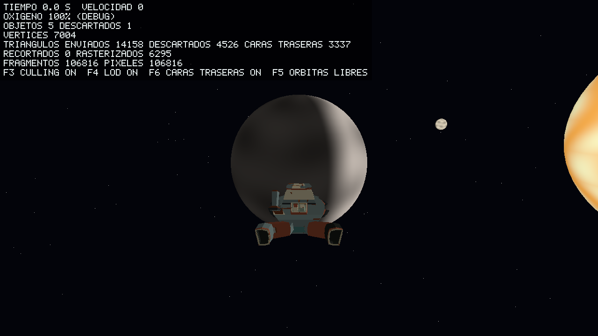

# UMBRAL: Asfixia Lúcida

Proyecto final de Gráficas por Computadora: exploración de un sistema solar pequeño desde una nave deteriorada, con un renderizador 3D **por software** escrito en Rust.

> **Candidato de integración visual/gameplay pendiente de revisión independiente; no publicado.** Los resultados de gates, deudas heredadas y límites de esta revisión están en la evidencia local `correction03/REPORT.json`. No certifica controles físicos ni juicio visual.

### Contrato integrado y límites de esta entrega

- `R` conserva la recolocación de cada ruta, incluida su prohibición durante captura. `Shift+R` pide partida nueva, también capturado o terminal; borra avance, no es una suelta.
- `World.reset_ship` conserva oxígeno/avance; `World.restart_game` es el reinicio completo. Las únicas migraciones de pruebas antiguas son siete llamadas de Persona 2, registradas byte a byte en el ledger de implementación.
- La reserva real se consume con `min(elapsed, 0.1)` en el bucle. La transición visual usa `elapsed` completo; `F5` congela sólo órbitas. Los presets y M/N son override visual; `0` vuelve al real con suavizado cuando hay percepción. Una cápsula no garantiza suelta si el override sigue bajo.
- Captura posee la trayectoria: gravedad, asistencia y colisiones no publican poses provisionales mientras está bloqueada. Recolección y objetivo usan el trayecto efectivamente publicado por el arrastre.
- Muerte por reserva real y victoria congelan nave, captura y reloj del arrastre hasta partida nueva. No se añade daño por captura ni audio. Sobre el cuadro congelado se dibuja la **presentación final** (ver «Final de partida»).
- Las balizas permanecen integradas. La franja técnica está desactivada por defecto; `--gameplay-feedback` la añade antes del postproceso final. F1/`--overlay` sigue siendo independiente. Pruebas headless comparan el RGB exacto y negro total a O2 cero.
- `ConfiguredGameOptions` es un envoltorio aditivo aceptado por las entradas existentes; conserva sus validadores. `OxygenSource::Real` y `OxygenSource::Debug` conservan el origen explícito, incluido `--debug-oxygen 1`. La conversión de `GameOptions` conserva la interpretación heredada (`Legacy`), no puede recuperar información que ese struct no contiene.
- Identidad: las rutas congeladas (terminal y reinicio) usan la misma identidad exacta del bind que el paso activo (`SpatialPursuit::check_bound_identity`, sólo lectura). Los cuadros compartidos `advance_auto_capture_frame` y `advance_capture_frame` validan esa identidad antes de devolver el estado congelado o reenlazar; una criatura ajena con la misma geometría es `Err` sin efectos.
- Terminal: el despacho del bucle (`dispatch_frame_keys`, `FrameKeys::gated`) ignora R, 7, 8, H, G, O, 0, 1-4, M/N, F7 y X; sólo `Shift+R` sigue disponible. Los relojes de la composición observadora y de las persecuciones no avanzan. F1-F6, P y Esc no cambian nave ni captura.
- `Shift+R` restablece el arranque de la ruta (`--near`, `--near-creature`, preset LEJOS de las candidatas), objetivo de mirada, H, giro, reloj y O2; cancela la composición observadora, reenlaza la persecución y limpia las notas.
- Headless, ventana y `P` comparten `compose_presentation`. Esa prueba cubre el código común, no la interacción física con la ventana.
- `Ship::update` satura los controles finitos en [-1, 1] (Persona 2). El caso que esperaba un desbordamiento de `yaw = f64::MAX` se sustituyó por la saturación coherente; los rechazos de NaN/±inf se conservan.
- Los componentes visuales puros se prueban con catálogos de gameplay vacíos explícitos; la escena integrada con sus seis balizas se prueba aparte.

Las secciones visuales históricas siguientes documentan las composiciones aprobadas, no anulan estas limitaciones. Detalle de gameplay: [docs/persona2.md](docs/persona2.md). Evidencia local fuera del snapshot versionable: `veli/branch_consolidation_01/implementation01/REPORT.json`, `correction01/REPORT.json`, `correction02/REPORT.json` y `correction03/REPORT.json`.



## Requisitos

- Rust y Cargo con soporte de la edición 2024. El manifiesto declara `rust-version = 1.88`; la base se verificó con **Rust 1.97.0 en Windows**. No se ha probado en Linux ni macOS.
- Dependencias fijadas en `Cargo.lock`: `minifb 0.28.0` (ventana y teclado) y `png 0.18.1` (exportar PNG). Ninguna dibuja ni carga geometría. Su aprobación académica sigue **pendiente** (UMB-004).

## Ejecutar

```bash
cargo run --release --locked
```

**Por defecto, en la ventana, el juego arranca con la experiencia completa:**

- Estrellas observadoras, que implican la percepción alterada.
- Superficie lúcida en Antena y ojo del vacío en Vigilia.
- Props y presentación final.
- **El monstruo «La Vigilia»** (`assets/creature`): vive en el centro del Sol y se revela con el O₂. **Cuando el O₂ real llega a 0 es la animación de muerte** (`visual::monster_death`): el monstruo toma el control y jala la nave hacia él, el tentáculo la atrapa y la arrastra (captura automática aprobada, sin cambios) y, a los 1.5 s de quedar retenida, llega la muerte con la pantalla final. Durante la secuencia el HUD muestra O₂ 0 % y «SIN OXIGENO - ALGO TE ARRASTRA»; si la captura no llegara en 25 s, la muerte llega igual. Se activa solo si `assets/creature` está completo y no se usan `--near`, `--near-creature` ni otras opciones de criatura.
- **Victoria al leer los tres registros**: en esta experiencia la partida se gana en cuanto recoges el tercer registro dorado, sin ir al Sol, con el final «EL SECRETO» («Has evitado caer en la locura»). `--classic` conserva la regla de siempre (tres registros y llegar al Sol).
- Tanque de oxígeno de **120 s**: los ojos aparecen hacia los 42 s, la percepción empieza a los 60 s y la muerte llega a los 120 s. `L` cambia el ritmo.
- **Espacio procedural por sectores** (`scene::sectors`): fuera del sistema solar (a más de 800 unidades del Sol) aparecen planetas errantes con props y tanques de oxígeno, generados por celdas de 700 unidades conforme avanzas. Son deterministas (al volver encuentras los mismos) y tienen colisión. En esta experiencia **cada tanque da +25 % de O₂** (`PRESENTATION_TANK_RECOVERY`; el juego clásico da +15 %).
- **Tanques de oxígeno modelados** (cian, con pulso) en lugar de las esferas pequeñas, y **marcadores en pantalla**: rombo cian «O2 distancia» para los 3 tanques más cercanos y rombo dorado «REG distancia» para los registros que faltan. Fuera de vista se pegan al borde.
- **HUD de oxígeno** arriba al centro (`visual::oxygen_hud`): instrumento oscuro hundido en el borde cuyo arco y lectura «O2 xx%» muestran el O₂ **real** y se vacían de derecha a izquierda conforme baja; va encima de la percepción para seguir legible con O₂ bajo y marca 0 % durante la muerte por el monstruo. Debajo queda un hueco reservado para el ojo y, bajo él, las notas: registros y tanques recogidos, aviso «+25% O2» al recoger un tanque y «SIN OXIGENO - ALGO TE ARRASTRA» durante la secuencia del monstruo.
- **`N`/`M` y `1`–`4` mueven también el O₂ real**: mientras el mostrado va al objetivo, el real lo sigue, así que al bajar con `N` hasta la pantalla negra llega la muerte y la pantalla final. Al alcanzar el objetivo, el forzado se suelta y el mostrado vuelve a seguir al real: los tanques suben el O₂ y los ojos desaparecen (ninguno con O₂ ≥ 65 %).

Equivale a `--watching-stars --lucid-surface --void-eye --oxygen-seconds 120` más el espacio procedural y las teclas de O₂ reales, que no tienen bandera propia. `--classic` arranca el juego sin nada de esto y con el tanque de 420 s, donde `N` vuelve a ser solo visual. Con `--headless`, `--legacy` o las candidatas de mirada (`--creature-eye-compare`, `--creature-distant-turn`, `--creature-horizontal-follow`) tampoco se activan solos, así que las capturas y pruebas conservan el cuadro de siempre.

| Tecla | Acción |
|---|---|
| `W` / `S` | Empuje hacia adelante / frenar y retroceder (suave, depende del tiempo) |
| `A` / `D` o flechas izquierda/derecha | Guiñada |
| Flechas arriba/abajo | Cabeceo |
| `Q` / `E` | Alabeo |
| `Shift` | Impulso ×5 para cruzar el sistema |
| `R` | Reiniciar la nave; en el modo solar, volver a la vista frontal |
| `Shift+R` | Partida nueva: nave, oxígeno, recursos, registros y terminales; también capturado |
| `O` | Alternar asistencia orbital. La entrada manual la interrumpe temporalmente; al soltar controles puede recapturar. Pulsa `O` para desactivarla de forma persistente. |
| `0` | Quitar el oxígeno visual de depuración y volver al oxígeno real |
| `P` | Guardar el framebuffer actual en PNG |
| `F1` | Mostrar/ocultar el overlay técnico (FPS, contadores de trabajo, interruptores) |
| `F3` | Activar/desactivar el descarte por frustum |
| `F4` | Activar/desactivar el nivel de detalle (LOD) |
| `F5` | Congelar/reanudar las órbitas (y, con `--void-eye`, la respiración de la corona de Vigilia) |
| `F6` | Activar/desactivar el descarte de caras traseras |
| `F2` | Mostrar/ocultar los props procedurales de los planetas |
| `L` | Ritmo del oxígeno real: el tanque completo dura 420 → 120 → 60 → 30 s y vuelve a 420 (el título de la ventana muestra O₂ real y tanque) |
| `1`–`4` | Oxígeno de depuración 100 / 50 / 25 / 5 %; controla la revelación en los modos de criatura y, con `--lucid-surface`, las grietas de Antena. Con `--lucid-perception` fija el **objetivo** y el O₂ llega de forma progresiva |
| `M` / `N` | Subir / bajar el oxígeno de depuración en pasos de 5 puntos (con `--lucid-perception`, el objetivo) |
| `7` / `8` | En el modo solar: vista frontal / oblicua |
| `G` / `H` | En el modo solar: objetivo cámara/nave / seguimiento horizontal ON/OFF |

| `Esc` | Salir |

El título de la ventana muestra FPS, velocidad y contadores (triángulos enviados, descartados y rasterizados, fragmentos).

Opciones implementadas: `--headless`, `--output archivo.png`, `--frames N` (cierra la ventana tras N frames), `--width N`, `--height N`, `--time S` (tiempo simulado inicial), `--near CUERPO` (arranca junto al cuerpo 0 = Sol, 1 = Antena, 2 = Osario, 3 = Vigilia), `--no-culling`, `--no-lod`, `--overlay` (dibuja el overlay también en `--headless`) y `--legacy` (visor ortográfico heredado). `--help` existe, pero su texto es básico y está desactualizado; actualizarlo queda pendiente.

Medición de rendimiento sin ventana: `cargo run --release --example frame_time` (escena) y `cargo run --release --example perf_bench` (escena, ojos y percepción por separado).

### Oxígeno para demostraciones

- `--oxygen-seconds S` fija cuántos segundos dura el tanque completo de oxígeno **real**; por defecto son 420 s. Por ejemplo, `--oxygen-seconds 60` hace que la percepción empiece a los 30 s, los ojos aparezcan hacia los 21 s y la muerte llegue al minuto.
- En juego, `L` alterna 420 / 120 / 60 / 30 s sin tocar el oxígeno que queda: solo cambia la velocidad desde ese momento. `Shift+R` conserva el ritmo elegido.
- Los **ojos en las estrellas** son opt-in: solo aparecen con `--watching-stars`, que también activa la percepción. Siguen al O₂ mostrado, que a su vez sigue al real; no hay ninguno con O₂ ≥ 65 %. Demostración completa:

```bash
cargo run --release --locked -- --watching-stars --lucid-surface --void-eye --oxygen-seconds 60
```

### Rendimiento: rasterización en paralelo

- `draw_model` reparte las **filas** de la pantalla entre hilos (`y % hilos`). Cada hilo recorre todos los triángulos en el orden de siempre y solo escribe sus filas, así que el cuadro es **idéntico bit a bit** al secuencial (`tests/parallel_raster.rs`). Solo se paraleliza un dibujo con más de 24 000 píxeles de cajas envolventes; los pequeños siguen en un hilo.
- La percepción (`lucid_perception_variant`) reparte bloques de filas en sus dos pasadas, con las mismas operaciones por píxel. Sus pruebas de RGB exacto siguen pasando.
- Hilos: hasta 8 (los núcleos disponibles). `UMBRAL_THREADS=1` vuelve al modo secuencial; sirve para comparar.
- Medición (`perf_bench`, release, 1280×720, `--lucid-surface --void-eye`, suma de 10 escenarios con O₂ 100 % y 30 %): **409 ms con 1 hilo → 172 ms con 8**. El peor caso, junto a Antena con O₂ 30 %, pasa de 87 ms (11 FPS) a 27 ms (37 FPS). Es una medición en una sola máquina de 32 hilos, no un benchmark general.

### Final de partida

Al agotarse el oxígeno o al llegar al Sol con los tres registros, la partida se congela (lógica de Persona 2, sin cambios) y `compose_presentation` añade como **última capa** el cierre de `visual::ending`:

- **Muerte («SIN OXIGENO»):** la escena se desatura hacia un rojo apagado y un iris se cierra hacia el centro durante 2.6 s.
- **Victoria («EL UMBRAL»):** destello blanco cálido que se asienta en un fondo ámbar con el resplandor del Sol al centro.
- Desde 1.4 s, el texto narrativo aparece letra por letra: el epílogo depende de los registros reunidos o del oxígeno restante. Después vienen el tiempo de misión, los recursos y los registros, y al final parpadea `SHIFT+R: NUEVA PARTIDA | ESC: SALIR`.
- El reloj (`EndingClock`) cuenta segundos **reales** y avanza como máximo 0.25 s por cuadro; `Shift+R` lo reinicia. En `--headless` con la partida terminada, el final se dibuja completo.
- Vista sin ventana de ambos finales y de los props: `cargo run --release --example ending_and_props` (escribe en `renders/smoke/`).

### Sol con ojo integrado

```bash
cargo run --release --locked -- --creature-model ruta/modelo.obj --creature-texture ruta/textura.png --creature-solar-reveal
```

Los assets de la criatura están en [`assets/creature/`](assets/creature/README.md); ahí está también el comando completo con la captura automática. El flag activa las etapas, la mirada a la cámara y el seguimiento horizontal aprobados; no requiere repetir sus flags individuales. Empieza en la vista frontal con oxígeno al 100 %, el Sol normal y las órbitas vivas. La revelación se prueba con `M`/`N` o los presets `1`–`4`: al 50 % exacto el ojo aún está oculto; aparece al bajar de ese umbral. El Sol visual se desvanece entre 30 y 25 %, sin apagar la iluminación global ni eliminar el cuerpo celeste lógico.

Sin el flag y sin assets externos se conserva el juego base. La composición está aceptada por Charlie; los detalles, restricciones, controles y pruebas están en [`docs/static-creature.md`](docs/static-creature.md#sol-con-ojo-en-el-juego-creature-solar-reveal). No se añade consumo automático de oxígeno ni colisiones.

### Superficie lúcida en Antena

```bash
cargo run --release --locked -- --lucid-surface --near 1
cargo run --release --locked -- --creature-model ruta/modelo.obj --creature-texture ruta/textura.png --creature-solar-reveal --lucid-surface
```

`--lucid-surface` (opt-in) cambia solo el shader del planeta Antena existente a la superficie lúcida aprobada por Charlie (variante 02): grietas rojo-ámbar que aparecen al bajar el oxígeno de 50 %. Con O₂ ≥ 50 % el cuadro es idéntico al juego sin el flag. Material, radio, órbita, rotación, LOD, descarte, cámara, nave y los demás cuerpos no cambian. El O₂ y el tiempo son los del juego (`--debug-oxygen`, `--time`, `1`–`4`, `M`/`N`); no hay consumo automático de oxígeno ni rótulos nuevos.

- `--near 1` arranca junto a Antena; `R` sigue reiniciando la nave como siempre.
- Se combina con el juego normal (también con la criatura estática y su revelación) o con `--creature-solar-reveal`, sin cambiar su composición ni sus teclas.
- Se rechaza con `--legacy` y, fuera del Sol con ojo, con `--creature-eye-compare`, `--creature-distant-turn` o `--creature-horizontal-follow`, antes de leer archivos.

Detalles, contrato y pruebas: [`docs/lucid-surface-preview.md`](docs/lucid-surface-preview.md#integración-en-el-juego---lucid-surface).

### Ojo del vacío en Vigilia

```bash
cargo run --release --locked -- --void-eye --near 3
cargo run --release --locked -- --void-eye --lucid-surface --near 3
cargo run --release --locked -- --creature-model ruta/modelo.obj --creature-texture ruta/textura.png --creature-solar-reveal --void-eye
```

`--void-eye` (opt-in) cambia solo el shader del planeta Vigilia existente al ojo del vacío aprobado por Charlie (UMB-309, variante 02): una pupila negra que mira siempre a la **nave** y una única corona rojo-ámbar que respira lentamente. Material, radio, órbita, rotación, fase, LOD, descarte, cámara, nave y los demás cuerpos no cambian. No depende del oxígeno.

- La respiración sigue el reloj de simulación (`--time`); `F5` la congela, pero el ojo sigue a la nave si esta se mueve. No hay teclas ni rótulos nuevos.
- `--near 3` arranca junto a Vigilia; `R` sigue reiniciando la nave como siempre.
- Se combina con el juego normal (también con la criatura estática y su revelación) o con `--creature-solar-reveal`, en ambos casos con o sin `--lucid-surface`. `G` del Sol con ojo cambia solo la mirada de la criatura, no el objetivo del ojo de Vigilia.
- Se rechaza con `--legacy` y, fuera del Sol con ojo, con `--creature-eye-compare`, `--creature-distant-turn` o `--creature-horizontal-follow`, antes de leer archivos.
- Integración promovida al proyecto principal y verificada por Veliona, con revisión independiente y pruebas de los lanzadores reales. La comprobación física de los controles queda a cargo de Charlie.

Detalles, contrato y pruebas: [`docs/void-eye-preview.md`](docs/void-eye-preview.md#integración-en-el-juego---void-eye).

### Percepción alterada por oxígeno

```bash
cargo run --release --locked -- --lucid-perception --near 3
cargo run --release --locked -- --lucid-perception --lucid-surface --void-eye --near 3
cargo run --release --locked -- --creature-model ruta/modelo.obj --creature-texture ruta/textura.png --creature-solar-reveal --lucid-perception
```

`--lucid-perception` (opt-in) aplica la percepción aprobada por Charlie (UMB-310, variante 02) como **último paso de color** de cada cuadro: grises + morado del monstruo, túnel que deja ver casi solo la nave y visión borrosa por debajo de 50 % de O₂, y negro total solo con O₂ 0. Con O₂ ≥ 50 % el cuadro es idéntico al juego sin el flag. El mundo se dibuja como siempre, con el O₂ vivo; el postproceso no toca profundidad, cámara ni geometría.

- **Progresivo:** `1`–`4` y `M`/`N` cambian el **objetivo** de O₂; el O₂ mostrado lo sigue en línea recta a 0.25 por segundo real (de 100 % a 0 en 4 s), al bajar y al recuperar, y llega exactamente. Ese O₂ gradual es el que reciben el Sol, Antena, la revelación y el postproceso. `F5` no congela la transición y `R` conserva O₂ y objetivo. Nada consume oxígeno solo.
- **Foco:** la nave proyectada con la cámara real (no el centro de la pantalla).
- Aplica a la ventana, a `P` y a `--headless`, también sobre `--overlay` (con O₂ 0 no queda texto encendido). El título muestra O₂ y objetivo; no hay HUD nuevo.
- Se combina con el juego normal o con `--creature-solar-reveal`, en ambos con o sin `--lucid-surface` y `--void-eye`. Se rechaza con `--legacy` y, fuera del Sol con ojo, con `--creature-eye-compare`, `--creature-distant-turn` o `--creature-horizontal-follow`, antes de leer archivos. `--output` debe ser `.png`.
- No incluye combate, ataque, daño ni estrellas observadoras.

Detalles, contrato y pruebas: [`docs/perception-game.md`](docs/perception-game.md).

### Estrellas observadoras

```bash
cargo run --release --locked -- --watching-stars
cargo run --release --locked -- --watching-stars --lucid-surface --void-eye --near 3
cargo run --release --locked -- --creature-model ruta/modelo.obj --creature-texture ruta/textura.png --creature-solar-reveal --watching-stars
```

`--watching-stars` (opt-in) integra las estrellas observadoras aprobadas por Charlie (UMB-310, preview02): las mismas 700 estrellas del cielo abren, según baja el O₂, ojos pequeños de 9×5 px cuya pupila mira a la nave proyectada con la cámara real. **Implica `--lucid-perception`** (pasarlo también es redundante): misma escena, mismo O₂ manual progresivo y la misma percepción como último paso de color.

- **Orden de cada cuadro** (inicial, `--headless`, ventana y `P`): escena real (juego normal o Sol con ojo) → ojos → `--overlay` y paneles → percepción. Los ojos nunca se pintan encima del overlay; con O₂ 0 la percepción deja todo en negro, overlay incluido.
- **O₂:** los ojos usan el O₂ **mostrado**, el mismo que el Sol, Antena, la revelación y la percepción. Con O₂ ≥ 65 % no hay ninguna observadora y el cuadro es el del juego sin el flag. `1`–`4`, `M`/`N`, `F5` y `R` funcionan igual que con `--lucid-perception`; no hay HUD, teclas ni consumo automático nuevos.
- Se combina con las mismas escenas que la percepción y se rechaza igual, antes de leer archivos: con `--legacy` y, fuera del Sol con ojo, con `--creature-eye-compare`, `--creature-distant-turn` o `--creature-horizontal-follow`. `--output` debe ser `.png`.
- Sin `--watching-stars`, todas las rutas (incluida `--lucid-perception`) quedan exactamente como antes.

Detalles, contrato y pruebas: [`docs/watching-stars-game.md`](docs/watching-stars-game.md).

### Resolución

| Parámetro | Valor |
|---|---|
| Por defecto | **1280×720 (16:9)**, decisión aprobada; definida solo en `src/config.rs` |
| `--width N` / `--height N` | Enteros positivos; cada uno sustituye su valor por defecto de forma independiente |
| Límite | `width × height ≤ 16 777 216` píxeles (`MAX_PIXELS`, equivale a 4096×4096), validado por `Framebuffer::new` antes de reservar memoria, incluido el desbordamiento de la multiplicación |

La ventana y el framebuffer se crean con las mismas dimensiones: no hay escalado ni cambio de tamaño de ventana. Un valor faltante, no entero, cero o demasiado grande termina con código 1 y un mensaje en `Error: ...`, sin escribir PNG ni abrir ventana. Las pruebas de corrección y los renders de regresión no constituyen un benchmark de la escena con la criatura.

- Solo en `--legacy`, la rotación avanza 0.03 rad **por frame**: es el comportamiento heredado. El vuelo del juego depende de `dt`.
La ventana y el framebuffer se crean con las mismas dimensiones: no hay escalado ni cambio de tamaño de ventana. Un valor faltante, no entero, cero o demasiado grande termina con código 1 y un mensaje en `Error: ...`, sin escribir PNG ni abrir ventana. Hay una escena de juego con actualización por `dt`; el rendimiento no se ha medido sistemáticamente.

- Solo el visor `--legacy` conserva giros de `A`/`D` de 0.03 rad por frame. El juego integra movimiento y giro usando `dt`.
- `P` escribe por defecto en `renders/nave.png`, ruta que `.gitignore` no excluye. Para pruebas manuales conviene `--output renders/tmp/vista.png`.
- Los controles se documentan a partir del código; su validación manual en ventana corresponde a Charlie y **no está registrada todavía**.

### Generar imagen sin ventana

```bash
cargo run --release --locked -- --headless --output renders/smoke/frame_720p.png
```

Usa el mismo renderer que la ventana, guarda el PNG a la resolución elegida (por defecto 1280×720) y termina. `renders/smoke/` y `renders/tmp/` están en `.gitignore`.

Para reproducir el **baseline heredado** hay que pedir `--legacy` y 1280×960:

```bash
cargo run --release --locked -- --legacy --headless --width 1280 --height 960 --output renders/smoke/legacy_960p.png
```

El PNG resultante debe ser idéntico byte a byte a `tests/fixtures/legacy_ship_1280x960.png`. El render a 720p es una imagen distinta y no reemplaza ese baseline.

## Validación local

```bash
cargo fmt --check
cargo clippy --all-targets --locked -- -D warnings
cargo test --locked
cargo run --release --locked -- --headless --output renders/smoke/frame_720p.png
cargo run --release --locked -- --legacy --headless --width 1280 --height 960 --output renders/smoke/legacy_960p.png
```

Con las dependencias ya descargadas puede añadirse `--offline`. Las pruebas cubren framebuffer y profundidad, rasterización en ambos órdenes de vértices, lector OBJ/MTL con la nave real, exportación PNG, la línea de comandos (resolución por defecto 1280×720 y rechazo de dimensiones inválidas) y una **regresión determinista de la nave**: `tests/ship_baseline.rs` compara el render a 1280×960 píxel a píxel y el PNG headless con `--width 1280 --height 960` byte a byte contra `tests/fixtures/legacy_ship_1280x960.png`. Ese fixture se generó con este repositorio y es idéntico al `renders/nave.png` del laboratorio de origen (SHA-256 `590617750436c32056a02602f94cfb9243e4398599005e94efefa99683e80bfa`).

Verificación posterior de esta reanudación, atribuida al coordinador: `cargo test --locked --no-fail-fast` y `cargo clippy --all-targets --locked -- -D warnings` pasaron. En esta reanudación, `cargo fmt --check` pasó después de aplicar `rustfmt` explícito con `skip_children=true` a la lista de Rust permitida.

El coordinador generó fuera del repositorio `scratch/umbral-persona2-prepublish.png` mediante ejecución headless a 640×360 con `near 1`; el feedback inferior es legible. Esta captura no acredita narrativa completa ni pilotaje humano.

## Estructura

```text
src/main.rs                 Línea de comandos; delega en app.rs (o en el visor --legacy)
src/app.rs                  Bucle de ventana, entrada y modo headless del juego
src/math/                   Vec2/3/4, Mat4 (MVP, Euler, Rodrigues) y Transform
src/renderer/pipeline.rs    draw_model: vértices, recorte, viewport, rasterización con shader
src/renderer/clipping.rs    Códigos de salida, recorte del plano cercano, Frustum
src/renderer/shader.rs      ShaderKind, ShaderContext, Material, shade_fragment, sRGB
src/renderer/rasterizer.rs  triangle (heredado) y triangle_shaded (perspectiva correcta)
src/renderer/stats.rs       RenderStats: contadores de trabajo
src/renderer/framebuffer.rs Color y z-buffer
src/renderer/image.rs       Exportación a PNG
src/renderer/legacy.rs      Visor heredado, solo con --legacy (baseline de regresión)
src/debug/overlay.rs       Overlay técnico con fuente de mapa de bits propia (F1)
src/scene/                  Cámara, nave, sistema solar y World (update + render)
src/gameplay/               Persona 2: oxígeno, recursos/registros, navegación y estados
src/assets/obj.rs           Lector OBJ/MTL: v, vt, vn, caras triangulares, Kd, esfera envolvente
src/assets/primitives.rs    Esfera UV generada por código
assets/models/ship/         OBJ y MTL de la nave
examples/frame_time.rs      Tiempo por cuadro con y sin descarte
tests/                      Pruebas heredadas, transformaciones, pipeline y mundo
docs/architecture.md        Propietarios, contratos y decisiones
```

Distribución procedural reproducible y anclaje orientado de props sobre esfera (UMB-304 y UMB-305, API y vistas técnicas, aún sin integrar en la escena): [`docs/procedural.md`](docs/procedural.md).

Preview técnico de un OBJ con textura PNG en CPU (vista separada del juego, sin integrar): [`docs/textured-preview.md`](docs/textured-preview.md).

Visor interactivo de la criatura con cámara orbital (ventana técnica aislada, sin integrar): [`docs/creature-viewer.md`](docs/creature-viewer.md).

Criatura texturizada dentro del juego: ruta estática, revelación por oxígeno, mirada, seguimiento horizontal y Sol con ojo integrado mediante flags explícitos; sin ellos, el juego no cambia: [`docs/static-creature.md`](docs/static-creature.md).

## Limitaciones conocidas

- Por defecto, los tres planetas comparten esfera y el shader iluminado; solo cambian tamaño, color y órbita. La identidad propia (UMB-302), props, procedural y shaders de Asfixia Lúcida son de Persona 3.
- `AnimatedSun` es una primera versión (UMB-307). `LucidSurface` (superficie lúcida aprobada) solo se usa en Antena con `--lucid-surface`, y `VoidEye` (ojo del vacío aprobado) solo en Vigilia con `--void-eye`.
- La percepción alterada solo existe con `--lucid-perception` y procesa el cuadro completo en CPU: a 720p con O₂ bajo cuesta más por cuadro (desenfoque y túnel); no se ha medido ni optimizado. La muestra de ataque del preview no está en el juego.
- Las estrellas observadoras solo existen con `--watching-stars`; recalculan en CPU el catálogo, el orden fijo y los ojos de las 700 estrellas en cada cuadro, sin medir ni optimizar. Al 25 % de O₂, con la percepción, se leen sutiles (aceptado por Charlie).

- La contribución de Persona 2 usa colisiones esféricas con barrido relativo lineal entre frames, no física orbital realista. En asistencia la cámara mira al planeta; en vuelo libre conserva el seguimiento del equipo. Los props futuros no tienen colisión propia.
- El LOD solo cubre las esferas de los cuerpos (tres niveles por tamaño aparente, con histéresis del 15 %); los props de Persona 3 aún no lo usan.
- El recorte se hace solo contra el plano cercano; los demás lados los resuelve la caja de pantalla del rasterizador (verificado con un triángulo de 2000 unidades que cruza la cámara).
- El descarte de objetos reduce vértices procesados, pero a 720p el tiempo lo domina el relleno de fragmentos; el efecto en milisegundos es pequeño.
- La ruta de los assets se fija con `CARGO_MANIFEST_DIR` al compilar: el binario no es reubicable.
- El baseline de la nave solo se ha verificado en Windows x86_64.
- El descarte de caras traseras se aplica a planetas y nave (la malla de la nave está cerrada y orientada hacia afuera, comprobado por prueba).
- El orden y sentido de la nave (`SHIP_MODEL_YAW`) se ajustó mirando un render; no hay prueba automática.

## Origen y atribución

- Código base, pruebas y modelo: [`carga-modelos-24531`](https://github.com/SrCharlied/carga-modelos-24531), commit `51fbaed7d6c5db12a264ce91b86f450e7b05dd34`, autor SrCharlied según su historial. El historial Git de ese laboratorio no se importó; esta referencia sustituye a la atribución por historial.
- Origen y hashes de la nave: `assets/models/ship/README.md`.
- Criatura (modelo generado con Meshy AI) y paquetes del tentáculo: `assets/creature/README.md`.

## Contribuciones

| Quién | Aporte en este repositorio |
|---|---|
| SrCharlied | Laboratorio base (código, pruebas, modelo) y dirección del proyecto |
| Persona 1, 2, 3 | Asignación pendiente; ver responsabilidades en `docs/architecture.md` |

## Gameplay de Persona 2

La reserva real dura 420 segundos sin cápsulas; cada cápsula turquesa recupera 15 %. Los tres registros dorados pueden recogerse en cualquier orden; después hay que acercarse al Sol para completar el objetivo (con `--classic`; en la experiencia por defecto se gana al recoger el tercero). La recolección es automática por proximidad o cruce del trayecto. El texto de feedback usa la fuente existente del equipo y no reemplaza su HUD artístico. La gravedad se activa modificando `gameplay.navigation.settings.gravity_strength`; su valor predeterminado es cero.

## Uso de asistencia de IA

- **UMB-001/UMB-002** (importación, renombre, reorganización de módulos, prueba de regresión de la nave y esta documentación inicial) se realizaron con **Claude Code** (Anthropic) bajo dirección de Charlie, con planificación y revisión apoyadas por un asistente de IA local. La revisión humana de este trabajo está pendiente.
- La integración de la criatura, su seguimiento y el Sol con ojo se realizó con asistencia de Claude Code y supervisión del asistente local; Charlie aprobó la composición y el resultado integrado. Las pruebas automatizadas y revisiones de código no sustituyen un registro pormenorizado de controles físicos.
- La contribución de Persona 2 se implementó y revisó con tres agentes **Codex** coordinados desde Hermes en **Herdr**, aprovechando un borrador inicial de gameplay generado con Hermes. Se mantuvo el renderer del equipo. La revisión y defensa humana siguen siendo responsabilidad de los integrantes.
- El uso de IA en el laboratorio de origen no está declarado en su README; debe completarlo su autor.
